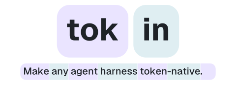

<h1 align="center">
  <picture>
    <source media="(prefers-color-scheme: dark)" srcset="assets/header-dark.svg">
    
  </picture>
</h1>

  
  
  

  <picture>
    <source media="(prefers-color-scheme: dark)" srcset="assets/gateway-dark.svg">
    
  </picture>

**tokin** is a gateway between an agent harness and an inference engine. The harness
keeps speaking text over a standard chat-completions API; the engine only ever receives
token ids. In between, tokin keeps each sample's session as a tree of turns, renders
every prompt by appending to the ids the model already sampled instead of re-encoding
text, and parses each generation back into an assistant message with its reasoning and
tool calls. Each leaf of the tree is a rollout a trainer can use as is.
